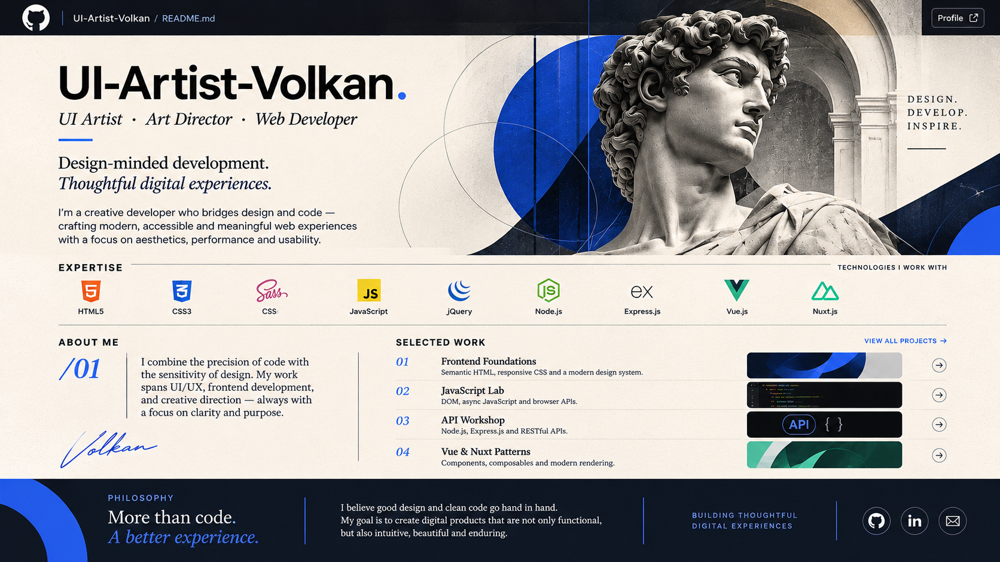

 

  

# VOLKAN.

### UI ARTIST · ART DIRECTOR · WEB DEVELOPER

*Design-minded development. Thoughtful digital experiences.*

I bring visual thinking and frontend engineering together to create digital experiences with clarity, character and purpose.

---

## 01 — EXPERTISE

**FRONTEND**

  

HTML5 · CSS3 · Sass · JavaScript · jQuery

**FRAMEWORKS**

Vue.js · Nuxt.js

**BACKEND**

Node.js · Express.js

---

## 02 — SELECTED WORK

*A curated collection of experiments, practical applications and independent projects.*

**01 / FRONTEND FOUNDATIONS**

Semantic HTML · CSS Architecture · Sass

**02 / JAVASCRIPT LAB**

DOM Manipulation · Async JavaScript · Browser APIs

**03 / API WORKSHOP**

Node.js · Express.js · REST APIs

**04 / VUE & NUXT**

Components · Composables · Rendering

---

## 03 — CREATIVE APPROACH

I believe good development is more than making things work.

It's about combining visual hierarchy, thoughtful interaction, performance and clean code to create meaningful digital experiences.

---

  **DESIGNED WITH PURPOSE.**
  
  **BUILT WITH CODE.**

